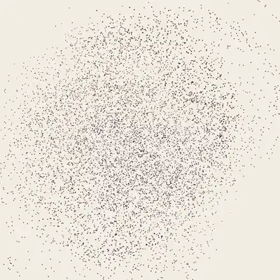

# brief2motion

Write a plain brief. Get a web page that moves: dust that turns into your face, your product or your logo, a paper plane that flies across the page, and scenes that play as you scroll. Every result is checked in a real browser before you get it.



brief2motion is a free skill for Claude Code. It is the sibling of [brief2mp4](https://github.com/qualixar/brief2mp4), which turns a brief into a finished video. Use brief2motion when you want the motion live on a website, and brief2mp4 when you want a video file. brief2motion can hand its page to brief2mp4 to become a video too.

## Install

In Claude Code:

```
/plugin marketplace add qualixar/brief2mp4
/plugin install brief2motion@brief2mp4
```

If you already use brief2mp4, skip the first line. You can also add this repo as its own marketplace: `/plugin marketplace add qualixar/brief2motion`, then `/plugin install brief2motion@brief2motion`.

You need Node.js 22 or newer and Google Chrome. The skill checks this for you and prints the install command for anything missing.

## Use it

Just ask, in your own words:

```
Make my product rise out of dust on my landing page. A paper plane flies across when I scroll.
[attach product.jpg]
```

```
Turn my photo into a halftone portrait made of dots, in colour, then morph it into my logo.
```

```
A hero for my bakery site: the word "Crumb" forms from flour dust, calm, no scroll.
```


You get, in your project folder:

| File | What it is |
|---|---|
| `site/` | The page. Open `site/index.html` in a browser, or copy the section into your own site. |
| `REPORT.md` | Every line of your brief, with the number or screenshot that proves it is done. |
| `check/shots/` | Screenshots at set points of the scroll, desktop and phone. |
| `final.mp4` | Only if you ask for a video. |

## What it checks before you see it

| Check | Must be |
|---|---|
| Desktop, 1440 x 900 | p95 frame time 20 ms or less (smooth at 60 fps) |
| Phone, 390 x 844, processor slowed 4x | p95 frame time 40 ms or less |
| Page weight from your project | 1.5 MB or less |
| Console errors | none |
| Visitor has reduced motion switched on | sees the finished shape, no motion |
| Browser without WebGL | sees a still image instead |

If a check fails, the skill fixes the page and checks again. It never relaxes a budget to pass.

## The three building blocks

- **Assemble**: dust forms an image or words, then bursts and re-forms as the next one (up to three). Two looks: `halftone` (round dots on a grid, sized by how dark the picture is; best for faces) and stipple (dense, organic; best for products and logos). `colour: 'photo'` gives every dot the colour of the picture under it.
- **Flight**: a paper plane, or any object, along a path across the page.
- **Scroll**: the scene plays as you scroll, with smooth scrolling.

Add `?play` to the page address to run the whole scene on its own, with no scrolling. Useful for screen recording.

Photos of people work best front-facing, calm, from the shoulders up. On a Mac the skill removes the background on your machine (Apple's own subject detection; nothing is uploaded).

## Licences

brief2motion is MIT. It loads three.js (MIT), GSAP 3.15 (free under GSAP's standard licence, which allows AI-written GSAP code) and Lenis (MIT) from a CDN at pinned versions, and bundles none of them. The skill writes a licence notice into every project it makes. [RESOURCES.md](RESOURCES.md) lists 49 open repos for motion work, each with its licence in plain words; a few are reference-only.

Use only images you own or may reuse. The portraits in the demo above are the author's own photo and two Wikimedia Commons photos under CC BY 2.0: Dario Amodei by UK Prime Minister, and Sam Altman by TechCrunch. They appear only as a demo of the effect. Nothing here suggests either person uses or endorses this project.

The particle-face idea was inspired by Thomas Cullen's faces playground. brief2motion is written from scratch and shares no code, images or data with it.

## Part of a small family

- [brief2mp4](https://github.com/qualixar/brief2mp4): a brief in, a checked video out.
- brief2motion: a brief in, live web motion out.

Made by Varun Pratap Bhardwaj. Issues and pull requests welcome.
