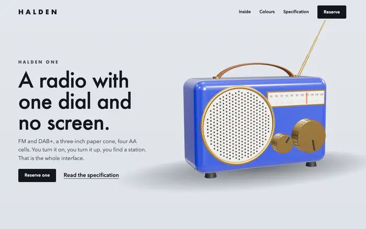
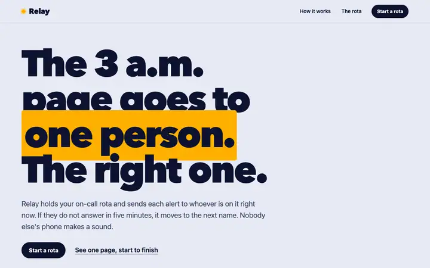
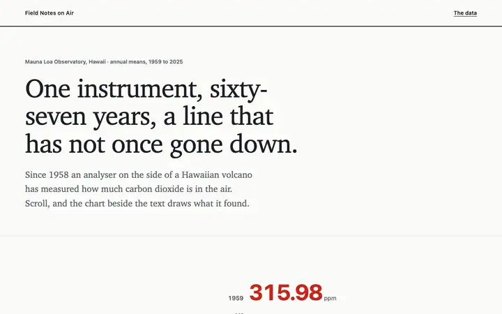
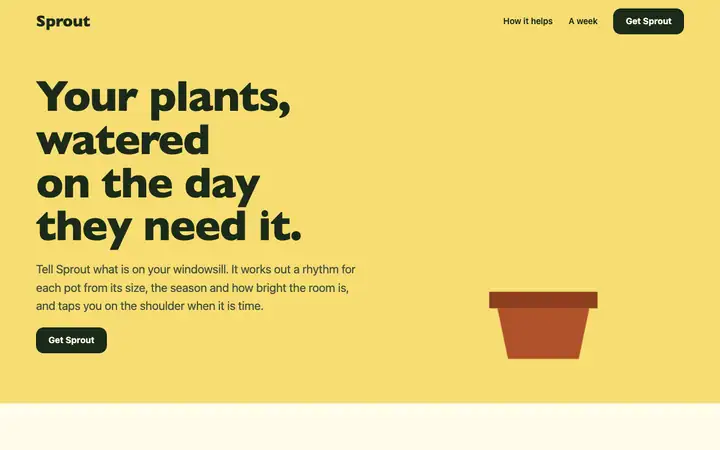

<p align="center">
  
</p>

<h1 align="center">brief2motion</h1>

<p align="center"><b>The website animation skill for Claude Code and Codex. Write a plain brief, get a website with professional motion (GSAP and ScrollTrigger scroll animation, three.js 3D, kinetic type, page transitions), built and then checked in a real browser for speed, layout and accessibility before you see it.</b><br>scroll stories · 3D product pages · landing pages and whole sites · kinetic type · page transitions · data stories · interface motion · particles that form a face · 27 motion patterns · 32 visual styles</p>

<table align="center">
  <tr>
    <td align="center" width="50%">
      <a href="https://youtu.be/fI3a3oDvLE4"></a><br>
      <b><a href="https://youtu.be/fI3a3oDvLE4">▶ Make a film AND a website</a></b><br>
      <sub>brief2motion builds the website, brief2mp4 the film</sub>
    </td>
    <td align="center" width="50%">
      <a href="https://youtu.be/aP2wHwG_dSA"></a><br>
      <b><a href="https://youtu.be/aP2wHwG_dSA">▶ Claude Code made a full documentary</a></b><br>
      <sub>Made with the sister skill, brief2mp4</sub>
    </td>
  </tr>
</table>

<p align="center">One install gives you both skills in Claude Code:<br><code>/plugin marketplace add qualixar/brief2mp4</code> then <code>/plugin install brief2mp4@brief2mp4</code></p>

<p align="center">
  <a href="https://github.com/qualixar/brief2motion"></a>
  
  <a href="https://github.com/qualixar/brief2motion/actions/workflows/test.yml"></a>
  <a href="LICENSE"></a>
  
  
  
</p>

<p align="center">
  <a href="#example-sites">Examples</a> ·
  <a href="#quick-start">Quick start</a> ·
  <a href="#what-it-builds">What it builds</a> ·
  <a href="#how-it-works">How it works</a> ·
  <a href="#site-mode-a-whole-site-or-a-page-that-must-convert">Site mode</a> ·
  <a href="#motion-patterns">Patterns</a> ·
  <a href="#visual-styles">Styles</a> ·
  <a href="#what-it-checks">Checks</a> ·
  <a href="#how-it-compares">Compare</a> ·
  <a href="#faq">FAQ</a> ·
  <a href="docs/README.md">Docs</a>
</p>

<p align="center">
  
</p>

<p align="center"><b>One brief, one page.</b> This is <a href="examples/halden-one/">Halden One</a>, built from <a href="examples/halden-one/BRIEF.md">this brief</a>: a radio made of about forty shapes in three.js, with no model file and no photo. It turns, opens into an exploded view and changes colour as you scroll. Its <a href="examples/halden-one/site-report.json">report</a> shows 28 of 28 checks passed, including a still picture for browsers without WebGL and cuts instead of travel for visitors who switch motion off.</p>

| You give it | You get back |
|---|---|
| A plain brief: what the site is for, what should move, the words on the page, pictures if you have them, and what "done" means. | A `site/` folder with a working site, a `REPORT.md` that goes through your brief line by line with the number or screenshot behind each line, and an `http://localhost` address to open it. |

brief2motion is a free, MIT-licensed agent skill for Claude Code and Codex. From your brief the agent picks a motion stack and a visual style and tells you why, writes a short spec with a checkable "done when" list, builds the site, starts a local preview, then measures it in a real Chrome: frame time on desktop and on an emulated phone, layout at three widths, keyboard focus, text contrast, and what a visitor sees with reduced motion, without WebGL and without JavaScript. If a check fails it fixes the page and measures again. Everything runs on your own machine.

<p align="center"><b>▶ brief2motion in 84 seconds:</b> one product photo and a brief become a website whose dust forms the bottle, then nine more sites in nine different motion stacks.</p>

https://github.com/user-attachments/assets/8b780cc9-e70f-4c7c-b3ac-7fdb56ede3ff

<p align="center">
  <a href="https://youtu.be/fI3a3oDvLE4"></a><br>
  <b><a href="https://youtu.be/fI3a3oDvLE4">▶ The full tutorial: Claude Code Motion Graphics, Make a Film AND a Website</a></b> (YouTube, English and Hindi audio) · <b><a href="docs/guide/brief2motion-guide.pdf">Free 63-page guide (PDF)</a></b>
</p>

<p align="center">⭐ <b>Free and MIT. If brief2motion builds a page you keep, <a href="https://github.com/qualixar/brief2motion">star the repo</a>.</b> It is the only signal I get that it worked for you, and it is how other Claude Code and Codex users find it.</p>

## Example sites

Every site below was built from a plain brief, in a different motion stack, and its report shows no failed check, measured in Chrome 158 on an Apple M-series laptop. Each folder in [`examples/`](examples/) holds the brief, the site, the motion plan at the top of its script and the report from its passing check. Click a picture to open the folder.

<table>
<tr>
<td width="50%"><a href="examples/tidewater/"></a><br><b>tidewater</b> · scroll story · GSAP, ScrollTrigger, Lenis · 28 of 28 checks</td>
<td width="50%"><a href="examples/relay/"></a><br><b>relay</b> · kinetic type · Motion · 28 of 28 checks</td>
</tr>
<tr>
<td><a href="examples/larkspur/"></a><br><b>larkspur</b> · site mode, three pages · CSS and JavaScript · 74 of 74 checks, plus 338 site-mode records PASS and 2 PENDING</td>
<td><a href="examples/halvorsen/"></a><br><b>halvorsen</b> · page transitions, five pages · View Transitions API · 120 of 120 checks</td>
</tr>
<tr>
<td><a href="examples/keeling/"></a><br><b>keeling</b> · data story · SVG and D3 scales, NOAA data · 28 of 28 checks</td>
<td><a href="examples/mise/"></a><br><b>mise</b> · interface motion · React and Motion for React · 28 of 28 checks</td>
</tr>
<tr>
<td><a href="examples/sprout/"></a><br><b>sprout</b> · illustration · SVG, Lottie, CSS scroll-driven animation · 28 of 28 checks</td>
<td><a href="examples/copper-no-7/"></a><br><b>copper-no-7</b> · particles · the dust engine · 28 of 28 checks, plus the dust engine's own check</td>
</tr>
</table>

The tenth example, [`style-atlas`](examples/style-atlas/), shows 28 visual styles on one page (see [Visual styles](#visual-styles)), and passes 28 of 28. Every product in the examples is made up, and each page says so. The one page with real numbers, `keeling`, takes them from NOAA's published file and links to it.

<p align="center">
  
</p>

<p align="center">The dust engine from version 0.1: one page, three faces made of round dots. It is still here, and it is now one stack of several.</p>

## Quick start

**Install it in Claude Code:**

```
/plugin marketplace add qualixar/brief2mp4
/plugin install brief2motion@brief2mp4
```

Installing or updating [brief2mp4](https://github.com/qualixar/brief2mp4), the video sister skill, installs brief2motion too, because brief2mp4 (0.4.0 or later) lists it as a dependency: `/plugin install brief2mp4@brief2mp4` gives you both. To use this repo on its own, add it as its own marketplace instead: `/plugin marketplace add qualixar/brief2motion`, then `/plugin install brief2motion@brief2motion`.

| You use | Run |
|---|---|
| Claude Code (plugin) | the two lines above |
| Codex (plugin) | `codex plugin marketplace add qualixar/brief2motion` then `codex plugin add brief2motion@brief2motion` (see the Codex question in the [FAQ](#faq)) |
| Either app, by hand | `git clone https://github.com/qualixar/brief2motion.git`, then copy `brief2motion/skills/brief2motion` into `~/.claude/skills/` (Claude Code) or `~/.codex/skills/` (Codex) |

Start a new session after installing so the app loads the skill. Check the machine at any time with `bash skills/brief2motion/scripts/doctor.sh`. It prints `ok` or the exact install command for each tool.

**Then make a site.** In a folder for the project, ask in your own words:

```
Build a launch page for our table radio. A 3D model of it that turns as I scroll,
opens up to show the parts, then lets me pick a colour. Headline: "A radio with one dial and no screen."
```

```
Tell the story of how we make sea salt as you scroll: a pinned scene where a crystal grows,
then the year in six cards.
```

```
A neubrutalism landing page for my newsletter tool. The headline sets itself word by word. No frameworks.
```

When it says it is done, it gives you a link such as `http://localhost:8421/`. Open that address in your browser. To start the preview yourself:

```bash
python3 skills/brief2motion/scripts/serve.py site     # or: node skills/brief2motion/scripts/serve.mjs site
```

**Do not open `site/index.html` by double-clicking it.** Browsers refuse to load JavaScript modules from a `file://` address, so you would see a blank page. The preview server is a few lines of standard-library code that serves the folder on `127.0.0.1` only. To publish, upload the `site/` folder to any static host.

When the page is up, send one follow-up:

> Check it against the brief.

That makes the agent go back to your original brief line by line, show the evidence for each line, fix what falls short and measure again.

### Write a good brief

The agent guesses less when the brief says more. A brief that works well has these parts:

```markdown
What it is: a launch page for Halden One, a table radio with one dial and no screen.
What moves: a 3D turntable of the radio that I can drag. As I scroll: the whole radio, a close-up of the dial,
an exploded view with the parts labelled, then a colour picker with four enamels.
Words on the page, exactly: headline "A radio with one dial and no screen." Button "Reserve one".
Images: none yet. Build the radio in code.
Look: a pale studio backdrop like product photography. The enamel is the only colour.
Stack: plain HTML, no build step.
Done when: the exploded view shows four labelled parts, there is a still picture when WebGL is off,
reduced motion cuts between poses, and p95 frame time is 20 ms or less on desktop.
```

The "done when" lines matter most, because they are what the checks measure. Say what the product is and who it is for, and the router can choose a style; name a style or a library, and it uses that. [`brief-words.md`](skills/brief2motion/references/brief-words.md) maps common brief phrases to stacks and settings, and the [guide](docs/guide/brief2motion-guide.pdf) goes through brief writing, every stack and every style in detail.

### Requirements

| Tool | Needed for | macOS | Windows | Ubuntu / Debian |
|---|---|---|---|---|
| Node.js 22+ | everything | `brew install node` | `winget install -e --id OpenJS.NodeJS.LTS` | [nodesource setup_22.x](https://github.com/nodesource/distributions) |
| Chrome or Chromium | the checks (a real browser with WebGL) | `brew install --cask google-chrome` | `winget install -e --id Google.Chrome` | `sudo apt install chromium`, or `npx playwright@1.65.1 install chromium` |
| playwright-core 1.65.1 | drives the browser for the checks | downloaded once on the first check into `~/.cache/brief2motion/deps` (about 14 MB, install scripts off) | same | same |
| Python 3 | the preview server (optional; `serve.mjs` does the same with Node) | preinstalled or `brew install python` | `winget install -e --id Python.Python.3.12` | `sudo apt install python3` |
| ffmpeg | a short film of the page (optional) | `brew install ffmpeg` | `winget install -e --id Gyan.FFmpeg` | `sudo apt install ffmpeg` |
| brief2mp4 | finishing that film as a checked MP4 (optional) | see [brief2mp4](https://github.com/qualixar/brief2mp4) | same | same |

Development and every run recorded here were on macOS with Chrome 157 and 158. The Windows and Linux paths are written but not run by the author. If something does not work, [troubleshooting](docs/troubleshooting.md) covers blank pages, busy ports, a browser that will not start and each failing check.

## What it builds

| Kind of site | What the skill does for it | Stack | Example |
|---|---|---|---|
| **Product launch with a 3D object** | a turntable you can drag, scroll poses, an exploded view with labels, colourways, a still picture when WebGL is off | [three.js](skills/brief2motion/references/stacks/three.md) (React Three Fiber and drei in React projects) | [halden-one](examples/halden-one/) |
| **Scroll story for a brand** | pinned scenes, a picture sequence scrubbed by scroll, a sideways gallery, text that reads itself | [GSAP, ScrollTrigger, Lenis](skills/brief2motion/references/stacks/gsap.md) | [tidewater](examples/tidewater/) |
| **Type-led landing page** | a headline that sets word by word, highlight wipes, rows of words that slide with the scroll, springs | [Motion](skills/brief2motion/references/stacks/motion.md) | [relay](examples/relay/) |
| **Portfolio with page transitions** | a thumbnail that grows into the next page and back, a grid that glides when filtered | [View Transitions API](skills/brief2motion/references/stacks/view-transitions.md) | [halvorsen](examples/halvorsen/) |
| **Data story** | one chart that redraws as you read, counters, a table and sources for every number | [SVG, D3 scales](skills/brief2motion/references/stacks/svg-players.md) | [keeling](examples/keeling/) |
| **App interface** | shared layout tabs, drag to reorder (and from the keyboard), items that travel between lists, numbers on springs | [React, Motion for React](skills/brief2motion/references/stacks/motion.md) | [mise](examples/mise/) |
| **Illustrated landing page** | an SVG drawing that draws and grows, Lottie icons that play only on screen, native CSS scroll-driven animation | [plain CSS and JavaScript](skills/brief2motion/references/stacks/vanilla.md), [lottie-web, Rive](skills/brief2motion/references/stacks/svg-players.md) | [sprout](examples/sprout/) |
| **Particles that form a picture** | dust that assembles into a product, a logo, a face or a word, and re-forms as up to four shapes | [the built-in dust engine](skills/brief2motion/references/stacks/particles.md) | [copper-no-7](examples/copper-no-7/) |
| **A whole site, or a page that must convert** | [site mode](#site-mode-a-whole-site-or-a-page-that-must-convert): discovery, content and claims, routes, wireframes, tokens, design, motion, then plan, layout, accessibility, journey and meta checks | plain CSS and JavaScript | [larkspur](examples/larkspur/) |

The rule is the lightest stack that does the job, and plain CSS and JavaScript is the default. Libraries load from cdn.jsdelivr.net at pinned versions (GSAP 3.15.1, three.js 0.187.0), with integrity hashes on script tags; three.js loads after the text is on screen; Lottie and Rive load when the animation nears the screen; React stacks are built by your project's own bundler. Cross-cutting references cover [kinetic type](skills/brief2motion/references/stacks/kinetic-type.md), [scroll storytelling](skills/brief2motion/references/stacks/scroll-story.md), [accessibility](skills/brief2motion/references/accessibility.md), [performance](skills/brief2motion/references/performance.md), [design fundamentals](skills/brief2motion/references/design-fundamentals.md) and when WebAssembly helps ([wasm.md](skills/brief2motion/references/stacks/wasm.md)).

Every stack shares one small kit of tested helpers in [`skills/brief2motion/kit/`](skills/brief2motion/kit/): the reduced-motion switch, frame loops that stop when hidden, scroll progress, accessible split text, counters, SVG line drawing, a picture-sequence scrubber, view-transition helpers, a three.js stage and Lottie and Rive loaders. No dependencies, about 30 KB of source. A development-only `?tune` panel (Tweakpane) gives sliders for a page's values, and `strip_tune.mjs` removes it before delivery.

## How it works

<p align="center">
  
</p>

The agent follows the same six steps for every brief, set out in [SKILL.md](skills/brief2motion/SKILL.md):

1. **Route.** [`route.mjs`](skills/brief2motion/scripts/route.mjs) reads the brief and proposes a motion stack, a visual style and the motion patterns that match, quoting the words that led there.
2. **Spec.** The agent writes `SPEC.md`: the stack and style with reasons (it may overrule the router and says so), a design plan, a motion plan, and a "done when" list that the checks can measure.
3. **Build.** The site goes into `site/`, content in the HTML first, motion on top, from the shared kit and the stack's reference page.
4. **Check.** [`check_site.mjs`](skills/brief2motion/scripts/check_site.mjs) opens the site in a real Chrome and measures it ([what it checks](#what-it-checks)). Site mode adds its own checkers.
5. **Fix.** Anything that fails is fixed and measured again. A budget is never relaxed to pass.
6. **Deliver.** A `localhost` address and `REPORT.md`, which answers every line of the brief with a measured number or a named screenshot.

This is the router on the Halden One brief (lines trimmed):

```
$ node skills/brief2motion/scripts/route.mjs examples/halden-one/BRIEF.md
Stack: three.js
  why: The brief wants a real 3D object or scene: something to turn, light and look around. Plain three.js needs no build step and is the lightest way to get there.
  the brief says: "3d", "turntable", "exploded view"
  read: references/stacks/three.md   study: examples/halden-one/
Pattern: 3D product that turns as you scroll (three): references/patterns/product-3d-scroll.md, because a real 3D object should change pose as the reader scrolls (the brief says "turntable", "exploded view")
Style: Minimalism (inferred)
  why: hardware sells on the object itself: a quiet page, one large product, little else ("radio")
Note: WebGL: ship a still picture for browsers without it, cap the pixel ratio at 2, stop the loop off screen.
```

Step 4 is the difference. A page that looks right on the screen it was built on is not yet a page that works on a phone, with a keyboard, or for someone who has motion switched off, so nothing is reported done until Chrome has measured it.

## Site mode: a whole site, or a page that must convert

For a brief that asks for several pages, or for one page whose job is to get a visitor to sign up, buy or book, the skill works in nine stages: **discovery, content and claims, routes, wireframes, tokens, design, motion, build, checks.** Each of the first seven writes one short file (`DISCOVERY.md`, `CONTENT.md`, `routes.json`, phone-first wireframes, `tokens.json`, `DESIGN.md`, `MOTION.md`; filled-in copies are in [`templates/site-mode/`](skills/brief2motion/templates/site-mode/)). The brief's own facts are the only facts: a drafted review, rating or logo fails the plan check.

| Script | What it checks |
|---|---|
| `check_plan.mjs` | every route reachable from home; every visitor task maps to a route and an action; every claim has a source or is marked DRAFTED; every asset has a rights record |
| `build_tokens.mjs` | `tokens.json` into `site/tokens.css`; no missing references or alias cycles; every declared text pair meets WCAG AA in light and dark |
| `check_layout.mjs` | at 320, 390, 768 and 1440 px: no overflow, clipped text or overlap, tap targets of 24 px (44 for the primary action on a phone), 45 to 75 characters a line, focus never under a sticky bar |
| `check_a11y.mjs` | axe-core on every route and declared state, light and dark, plus a Tab walk to the primary action |
| `check_journeys.mjs` | the visitor's tasks from `journeys.json`, by role and name, on a phone and a desktop width |
| `check_meta.mjs` | title, description, canonical link, share image, robots, `sitemap.xml` |

Every record lands in `check/qa.json` as PASS, FAIL, REVIEW (a person must look) or PENDING (no evidence yet). A run with anything PENDING ends `RESULT: INCOMPLETE`, never PASS, and `--strict` turns REVIEW and PENDING into a failing exit code for the release run. [Larkspur](examples/larkspur/), a three-page launch site for a made-up product, shows the whole path: 338 records PASS and 2 stay PENDING, because its sign-up form is a fixture and no tool can prove a service that does not exist.

**[Read the site mode guide](docs/site-mode.md)** for each stage, every checker, the outcomes and a walkthrough of Larkspur.

## Motion patterns

27 recipes for the motion that briefs ask for most. The router lists the ones whose words appear in your brief, and each recipe gives when to use it and when not, the stack, a performance and accessibility budget, its reduced-motion form and a sketch to start from.

| Group | Patterns |
|---|---|
| Entrances and text | hero load sequence, text line reveal, words that read themselves, mask reveal, number counter, marquee |
| Scroll | step scrollytelling, pinned scene scrubbed by scroll, horizontal scroll, image sequence scrub, parallax depth, scroll progress bar, section colour shift, scroll-snap carousel |
| Pointer | magnetic button, cursor follower, tilt and spotlight cards, bento grid with motion |
| Transitions | page transition, shared element morph, filter, sort and reorder, theme toggle |
| Drawing, 3D and particles | SVG line drawing, Lottie or Rive spot, 3D product that turns as you scroll, shader background, dust that forms a picture |

**[All 27 patterns, with when to use each and its reduced-motion form](docs/motion-patterns.md).** The timing and easing rules they share are in [motion-doctrine.md](skills/brief2motion/references/motion-doctrine.md).

## Visual styles

Web motion sits on a design, so the skill knows the major visual styles of web design. [`styles.md`](skills/brief2motion/references/styles.md) indexes 32 of them, each checked against a published source, each with its own page: what it is, signature rules, design tokens, tested CSS, the motion that fits, its accessibility traps and when to choose it.

| Family | Styles |
|---|---|
| Surface | neubrutalism, web brutalism, glassmorphism, Liquid Glass-inspired, neumorphism, claymorphism, skeuomorphism, flat design, Material Design 3 |
| Layout and type | Swiss / International Typographic Style, minimalism, maximalism, bento grid, editorial |
| Retro and themed | Y2K, Frutiger Aero, vaporwave, synthwave, Memphis, Corporate Memphis, Art Deco, cyberpunk, glitch |
| Treatments | aurora / mesh gradient, grain, duotone, dark-mode-first, isometric |
| Motion-led approaches | kinetic typography, scroll-driven storytelling, 3D / immersive WebGL, micro-interactions |

<p align="center">
  <a href="examples/style-atlas/"></a>
</p>

The 28 visual looks are live on one page, [`examples/style-atlas/`](examples/style-atlas/): the same small product fragment in every style, so they can be compared and measured. The atlas, the 32 reference pages and the router all come from one data file, so they cannot drift apart.

The router picks a style from what the brief says about the product, the audience and the mood, and says why. A brief for a bank's savings account gets Swiss; one for a children's reading app gets claymorphism; one that names glassmorphism gets glassmorphism. A brand's own colours and type always replace a style's tokens. Names that are not real styles are listed as such: "spectromorphism", for one, does not exist as a design style.

## What it checks

`check_site.mjs` runs these accessibility, performance and layout checks on every page, in a real Chrome:

| Check | Must be |
|---|---|
| Desktop, 1440 x 900, idle and scrolling | p95 frame time 20 ms or less |
| Emulated phone, 390 x 844, touch, processor slowed 4x | p95 frame time 40 ms or less |
| Layout at 1440, 390 and 320 px wide | no sideways scroll at any scroll position |
| Tap targets on the phone | 24 px or more (WCAG 2.5.8) |
| Reduced motion switched on | the page reports it, nothing keeps animating, two screenshots 0.7 s apart are identical, every heading and paragraph is visible, normal scrolling works |
| Browser without WebGL | the headline is readable and a still stands in for each WebGL canvas |
| JavaScript off | the page still reads |
| Text contrast | WCAG AA (4.5:1, or 3:1 for large text), with see-through panels blended before measuring |
| Keyboard | every stop has a visible focus ring and is on screen |
| Basics | one `<h1>`, `lang`, a real title and description, zoom allowed, `alt` text, a `<main>` and a skip link |
| Page weight from your project | 1.5 MiB or less per page |
| Third-party requests | only `cdn.jsdelivr.net` |
| Development tools | the `?tune` panel is not in the shipped page |
| Console errors, every run | none |

If a check fails, the skill fixes the page and checks again. It never relaxes a budget to pass. The phone run is an emulated phone: this machine's graphics chip with the processor slowed down. On a machine with no GPU, pass `--no-perf`; the frame numbers there say nothing about real devices. Text over pictures, gradients and canvas has no single background, so it is not measured: the agent looks at the screenshots, and so should you.

Three test layers back the checker up: unit tests for the router, the kit, the measuring code and the site-mode checkers (each with a passing and a failing fixture); a real-browser smoke test per stack that proves each documented pattern does what it says (the poster really morphs between pages, keyboard reorder really moves the row, the canvas really changes with scroll); and the full check on every example.

## Works with brief2mp4: the video side

brief2motion makes the website. Its sister skill [brief2mp4](https://github.com/qualixar/brief2mp4) makes the video: write a plain brief and get a finished MP4, checked before you see it, with a `REPORT.md` that backs every line of the brief with a measurement or a still. It renders kinetic type, charts, 3D scenes and particles in 82 animation art forms, from claymation and paper cut-outs to anime and VHS.

https://github.com/user-attachments/assets/8e975937-03d7-4648-b527-19b712c7e6c8

The two skills hand work to each other: brief2motion films its own page with `capture_site.mjs --film`, and brief2mp4 finishes that footage as a checked MP4 for a launch video, a Short or a README. Installing brief2mp4 installs both ([quick start](#quick-start)). The [tutorial film](https://youtu.be/fI3a3oDvLE4) shows both at work, a story film and a website from the same brief.

## How it compares

| | brief2motion | The same agent, no skill | Copying animated components |
|---|---|---|---|
| Chooses the motion library | from the brief, with the words that led there, lightest first | whatever you or it reaches for | you choose per component |
| Plans before code | `SPEC.md` with a measurable "done when" list | only if you ask | no |
| Measured in a real browser | frame time on desktop and an emulated phone, layout at three widths, contrast, focus, weight | only if you write the test | no |
| Reduced motion, no WebGL, no JavaScript | each one run and checked | only if you ask | depends on the component |
| Whole sites | site mode: plan, wireframes, tokens, journeys, accessibility and meta checks | only if you ask | no |
| What you get | plain files you own and can host anywhere, plus a report | plain files | components inside your own app |
| Cost | free, MIT; runs on your own Claude Code or Codex plan | your plan | varies |

Where it is not the right tool: it builds static sites and front ends, not back ends, content management or payments; its phone numbers come from an emulated phone, not a real device; and a green report is a floor, not a design review or a screen-reader audit.

## FAQ

**How do I make website animations with Claude Code?** Install brief2motion, then describe the site in plain words: what it is for, what should move, the exact words. The skill picks the motion stack and a visual style, builds the site, checks it in Chrome and gives you a `localhost` link. The [quick start](#quick-start) has three briefs you can paste.

**Is there a GSAP or three.js skill for Claude Code?** brief2motion covers both, and more: GSAP with ScrollTrigger and Lenis for scroll animation, three.js and React Three Fiber for 3D websites, Motion, the View Transitions API, SVG and D3, Lottie, Rive, native CSS scroll-driven animation and its own particle engine. Each has a reference file with tested patterns in [`references/stacks/`](skills/brief2motion/references/stacks/).

**Can it build a whole website, not just one animated page?** Yes. Site mode plans the routes, content, wireframes and design tokens before it builds, then checks layout, accessibility, journeys and metadata on every page. See [site mode](docs/site-mode.md) and the [Larkspur example](examples/larkspur/).

**Which visual styles does it know?** 32, from neubrutalism, glassmorphism, neumorphism and claymorphism to Swiss, bento, Y2K, vaporwave, Art Deco and cyberpunk, each with design tokens, the motion that suits it, its accessibility pitfalls and sources. See [visual styles](#visual-styles). Your brand's own colours and type replace a style's tokens.

**Does it cost anything?** The skill is free and MIT licensed. The agent runs on your own Claude Code or Codex plan, and the checks run on your machine.

**Does it work in Codex?** The repo carries a Codex plugin manifest and marketplace file, and the skill is plain scripts and files that Codex can run. The author built and checked it from Claude Code and has not recorded a Codex run, so treat Codex as untested and open an issue if something breaks.

**Does it upload my files anywhere?** No. Your pictures, the site, the checks and the report stay in your project folder. A built page loads its libraries from `cdn.jsdelivr.net` when a visitor opens it, the first check downloads `playwright-core` from npm once, and the site-mode accessibility check fetches axe-core from cdn.jsdelivr.net.

**Which frameworks does it support?** A plain static site with no build step is the default and the best tested. For React and Next.js projects the references cover Motion for React and React Three Fiber, and the examples include a React page; those stacks should be built by your project's own bundler. Vue, Svelte and Astro projects can use everything that is not React-specific.

**Is the motion accessible?** Every page has a reduced-motion branch that the checker verifies, keyboard paths for anything draggable, focus rings, and content in the HTML. In site mode axe-core runs on every route as well. That is a floor, not an audit: test with a screen reader and real users before you rely on it.

**Will it work on a real phone?** The check measures an emulated phone, which is this machine's graphics chip with the processor slowed 4x. It catches layout and most performance problems. It is not a real device, so look at the page on yours.

**Can I use the scripts without an agent?** Yes. `node skills/brief2motion/scripts/route.mjs BRIEF.md` suggests a stack and style, `check_site.mjs <folder>` measures any static site that reports its motion state, and `capture_site.mjs <folder> --out media --film` takes pictures and a short film of it.

**Can it make a video of the page?** `capture_site.mjs --film` makes a short loop of a scroll-through (the pictures in this README were made that way). For the dust engine, `to_video.sh` records a frame-exact run and hands it to [brief2mp4](https://github.com/qualixar/brief2mp4) when installed.

**How do I update or remove it?** Claude Code: `claude plugin update brief2motion@brief2mp4` or `claude plugin uninstall brief2motion@brief2mp4` (use `@brief2motion` if you added this repo as its own marketplace). Codex: `codex plugin marketplace upgrade` or `codex plugin remove brief2motion@brief2motion`. By hand: delete the folder you copied.

## What is inside

```
.claude-plugin/ .codex-plugin/ .agents/   plugin manifests and marketplace files
skills/brief2motion/
  SKILL.md                the loop the agent follows (route, spec, build, check, fix, deliver)
                          and site mode
  kit/                    helpers every site copies: motion-core, split-text, reveal, counter,
                          svg-draw, image-sequence, view-transitions, three-stage, players,
                          kit.css, and tune.js (dev only)
  references/
    stacks/               one page per stack, patterns taken from the tested examples
    styles.md, styles/    the 32 styles: an index and one page each (from styles.json)
    patterns/             27 motion pattern recipes: sketch, budget, reduced motion, checks
    page-blueprints.md    what each kind of page contains, in what order
    design-review.md      the second reader's rubric
    motion-doctrine.md    timing, easing and pacing rules
    web-references.md     sites to study, with their stated terms
    design-fundamentals.md, accessibility.md, performance.md, brief-words.md,
    licences.md, routing.json
  scripts/                route, check_site, check_motion, capture_site, serve.py, serve.mjs,
                          doctor.sh; site mode: check_plan, check_layout, check_a11y,
                          check_journeys, check_meta, build_tokens, build_sitemap; and
                          build_styles, strip_tune, check_links, capture_frames, to_video.sh,
                          cutout.swift
  templates/              SPEC.md, site/ (the dust engine starter), site-mode/ (every stage file)
examples/                 ten complete sites, each with its brief and its passing report
tests/                    unit tests, checker fixtures, browser smoke tests, repo checks
docs/                     site mode, motion patterns, troubleshooting, the guide (PDF and source)
CHANGELOG.md, NOTICE      what changed in each release; licences of what ships or loads
```

## Credits

brief2motion is built on these tools. Sites it builds load the libraries from a CDN at pinned versions and bundle none of them; no code from another project is copied into this repository.

| Tool | By | Licence | Used for |
|---|---|---|---|
| [three.js](https://threejs.org/) 0.187.0 | mrdoob and the three.js authors | MIT | 3D stacks and `kit/three-stage.js` |
| [React Three Fiber](https://github.com/pmndrs/react-three-fiber) and [drei](https://github.com/pmndrs/drei) | Poimandres | MIT | 3D inside React projects |
| [GSAP](https://gsap.com/) 3.15.1 with ScrollTrigger, SplitText, DrawSVG and MotionPath | GreenSock | GSAP Standard "no charge" licence | scroll, text and path choreography |
| [Lenis](https://lenis.dev/) | darkroom.engineering | MIT | smooth scrolling |
| [Motion](https://motion.dev/) | Motion | MIT | springs and layout animation, vanilla and React |
| [React](https://react.dev/) and [htm](https://github.com/developit/htm) | Meta; developit | MIT; Apache-2.0 | the React example |
| [lottie-web](https://github.com/airbnb/lottie-web) and the [Rive runtime](https://github.com/rive-app/rive-wasm) | Airbnb; Rive | MIT | animation files from designers |
| [d3-scale and d3-shape](https://d3js.org/) | the D3 authors | ISC | chart maths in the data story |
| [Tweakpane](https://tweakpane.github.io/docs/) | cocopon | MIT | the dev-only `?tune` panel, never shipped |
| [playwright-core](https://playwright.dev/) | Microsoft | Apache-2.0 | drives Chrome for the checks; downloaded on first use |
| [axe-core](https://github.com/dequelabs/axe-core) 4.14.1 | Deque Systems | MPL-2.0 | `check_a11y.mjs`; fetched at check time, hash-checked, never in a built site |
| [FFmpeg](https://ffmpeg.org/) | the FFmpeg developers | LGPL-2.1 or later (GPL in some builds) | optional: the short film of a page |
| [LYGIA](https://lygia.xyz/) and [Depth Anything V2 Small](https://huggingface.co/onnx-community/depth-anything-v2-small) | Patricio Gonzalez Vivo; the Depth Anything authors | Prosperity Public License 3.0 or Patron License; Apache-2.0 | optional add-ons, never bundled |
| [WeasyPrint](https://weasyprint.org/) and [PyMuPDF](https://github.com/pymupdf/PyMuPDF) | CourtBouillon; Artifex | BSD-3-Clause; AGPL-3.0 | building and checking the guide PDF |
| [Inter](https://github.com/rsms/inter), [Space Grotesk](https://github.com/floriankarsten/space-grotesk) and DejaVu Sans Mono | the Inter, Space Grotesk and DejaVu authors | SIL Open Font License 1.1; Bitstream Vera licence | fonts in the guide |

GSAP's "no charge" licence allows commercial use, including GSAP code an AI wrote; it does not allow use inside no-code animation builders that compete with Webflow. [`licences.md`](skills/brief2motion/references/licences.md) has the full table, with exact versions and what each licence means for you, and [NOTICE](NOTICE) lists the software built sites load and the data, images and fonts that ship.

## Contributing

Made something with it? Open an issue with the brief and a screenshot; the useful ones get added to the examples with your name on them. A page that failed a check is the most useful bug report: include the brief and `site-report.json` (or `check/qa.json` in site mode). Code changes are welcome; run `bash tests/run_checks.sh`, `node --test tests/*.test.mjs` and, with Chrome installed, `node tests/browser/smoke.mjs` first. To add a style, add an entry to `references/styles.json` with its sources and a CSS file beside it, then run `scripts/build_styles.mjs`. To add a motion pattern, follow [the steps in motion-patterns.md](docs/motion-patterns.md#adding-a-pattern). Releases are listed in [CHANGELOG.md](CHANGELOG.md).

## Licence

brief2motion is [MIT](LICENSE).

**Data.** The carbon dioxide numbers in `examples/keeling` are NOAA's annual means for Mauna Loa: Dr. Xin Lan, NOAA/GML ([gml.noaa.gov/ccgg/trends](https://gml.noaa.gov/ccgg/trends/)) and Dr. Ralph Keeling, Scripps Institution of Oceanography ([scrippsco2.ucsd.edu](https://scrippsco2.ucsd.edu/)).

**Images.** The portraits in the faces demo are the author's own photo and two Wikimedia Commons photos under CC BY 2.0. Each was cropped, resized and rendered as dots; the originals are unchanged on Commons.
- [Dario Amodei in 2023.jpg](https://commons.wikimedia.org/wiki/File:Dario_Amodei_in_2023.jpg) by UK Prime Minister, licensed [CC BY 2.0](https://creativecommons.org/licenses/by/2.0/).
- [Sam Altman TechCrunch SF 2019 Day 2 Oct 3 (cropped) (cropped).jpg](https://commons.wikimedia.org/wiki/File:Sam_Altman_TechCrunch_SF_2019_Day_2_Oct_3_(cropped)_(cropped).jpg) by TechCrunch, licensed [CC BY 2.0](https://creativecommons.org/licenses/by/2.0/).

They appear only as a demo of the effect. Nothing here suggests either person uses or endorses this project. The perfume pictures in `examples/copper-no-7/` are generated images of made-up products; see its [CREDITS.md](examples/copper-no-7/CREDITS.md). Every other picture in the examples is drawn by code in this repository.

Made by [Varun Pratap Bhardwaj](https://github.com/qualixar). If a page it made is on your site, a star on the repo is the thank-you that helps most.
