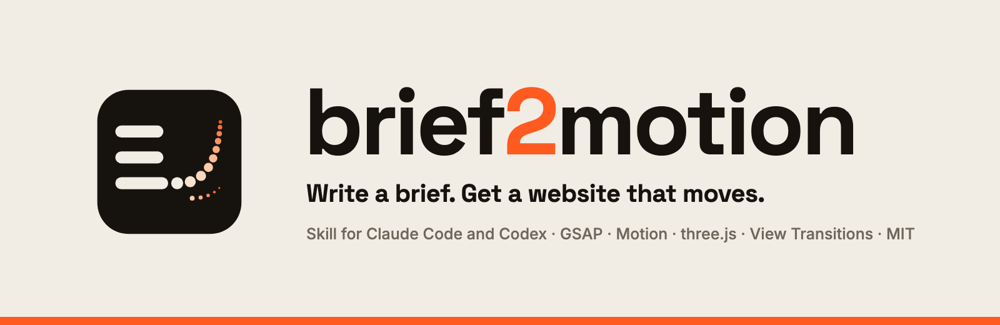
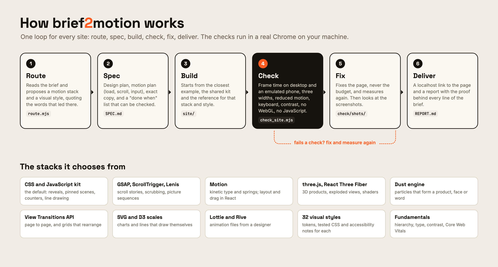
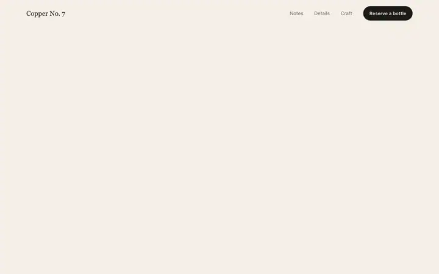

<p align="center">
  
</p>

<h1 align="center">brief2motion</h1>

<p align="center"><b>The website animation skill for Claude Code and Codex. Write a plain brief, get a website with professional motion (GSAP scroll animation, three.js 3D, kinetic type, page transitions), checked in a real browser before you see it.</b><br>scroll stories · 3D product pages · kinetic type · page transitions · data stories · interface motion · particles that form a face · 32 visual styles</p>

<p align="center">
  <a href="https://github.com/qualixar/brief2motion/stargazers"></a>
  
  <a href="https://github.com/qualixar/brief2motion/actions/workflows/test.yml"></a>
  <a href="LICENSE"></a>
  
  
  
</p>

<p align="center">
  <a href="#watch-it">Watch it</a> ·
  <a href="#quick-start">Quick start</a> ·
  <a href="#what-it-makes">What it makes</a> ·
  <a href="#the-stacks-it-chooses-from">Stacks</a> ·
  <a href="#the-style-system">Styles</a> ·
  <a href="#what-it-checks">Checks</a> ·
  <a href="#examples">Examples</a> ·
  <a href="#write-a-brief">Write a brief</a> ·
  <a href="https://qualixar.com/learn/guides/brief2motion-guide">Free 53-page guide</a> ·
  <a href="#faq">FAQ</a>
</p>

<p align="center">
  
</p>

<p align="center"><b>One brief, one page.</b> This is <a href="examples/halden-one/">Halden One</a>, built from <a href="examples/halden-one/BRIEF.md">this brief</a>: a radio made of about forty shapes in three.js, with no model file and no photo. It turns, opens into an exploded view and changes colour as you scroll. Its <a href="examples/halden-one/site-report.json">report</a> shows 27 of 27 checks passed, including a still picture for browsers without WebGL and cuts instead of travel for visitors with reduced motion.</p>

<p align="center"><b>▶ brief2motion in 84 seconds:</b> one product photo and a brief become a website whose dust forms the bottle, then nine more sites in nine different motion stacks.</p>

https://github.com/user-attachments/assets/8b780cc9-e70f-4c7c-b3ac-7fdb56ede3ff

<h2 id="watch-it" align="center">Watch the full tutorial</h2>

<p align="center">
  <a href="https://youtu.be/fI3a3oDvLE4"></a>
</p>

<p align="center">
  <b><a href="https://youtu.be/fI3a3oDvLE4">▶ Claude Code Motion Graphics: Make a Film AND a Website</a></b> (YouTube, English and Hindi audio) &nbsp;·&nbsp; <b><a href="https://qualixar.com/learn/guides/brief2motion-guide">Free 53-page learning guide</a></b> &nbsp;·&nbsp; <b><a href="https://github.com/qualixar/brief2mp4">brief2mp4, the video sister skill</a></b>
</p>

| You give it | You get back |
|---|---|
| A plain brief: what the site is for, what should move, the words on the page, pictures if you have them, and what "done" means. | A `site/` folder with a working site, a `REPORT.md` that goes through your brief line by line with the number or screenshot behind each line, and an `http://localhost` address to open it. |

brief2motion is a free, MIT-licensed agent skill. From your brief the agent picks a motion stack and a visual style and tells you why, writes a short spec with a checkable "done when" list, builds the site, starts a local preview, then measures it in a real Chrome: frame time on desktop and on an emulated phone, layout at three widths, keyboard focus, text contrast, and what a visitor sees with reduced motion, without WebGL and without JavaScript. If a check fails it fixes the page and measures again. Everything runs on your own machine.

<p align="center">
  
</p>

<p align="center">⭐ <b>Free and MIT. If brief2motion builds a page you keep, <a href="https://github.com/qualixar/brief2motion">star the repo</a>.</b> It is the only signal I get that it worked for you, and it is how other Claude Code and Codex users find it.</p>

## Quick start

**Install it in Claude Code:**

```
/plugin marketplace add qualixar/brief2mp4
/plugin install brief2motion@brief2mp4
```

**Already use brief2mp4?** From brief2mp4 0.4.0, installing or updating brief2mp4 installs brief2motion too, because brief2mp4 lists it as a dependency. Run `/plugin install brief2mp4@brief2mp4` (or `/reload-plugins` after an update) and both skills are there.

If you do not use brief2mp4, add this repo as its own marketplace instead: `/plugin marketplace add qualixar/brief2motion`, then `/plugin install brief2motion@brief2motion`.

| You use | Run |
|---|---|
| Claude Code (plugin) | the two lines above |
| Codex (plugin) | `codex plugin marketplace add qualixar/brief2motion` then `codex plugin add brief2motion@brief2motion` (see the Codex note in the FAQ) |
| Either app, by hand | `git clone https://github.com/qualixar/brief2motion.git`, then copy `brief2motion/skills/brief2motion` into `~/.claude/skills/` (Claude Code) or `~/.codex/skills/` (Codex) |

Start a new session after installing so the app loads the skill. Check the machine at any time with `bash skills/brief2motion/scripts/doctor.sh`. It prints `ok` or the exact install command for each tool.

**Then make a site.** In a folder for the project, ask in your own words:

```
Build a launch page for our table radio. A 3D model of it that turns as I scroll,
opens up to show the parts, then lets me pick a colour. Headline: "A radio with one dial and no screen."
```

```
Tell the story of how we make sea salt as you scroll: a pinned scene where a crystal grows, then the year in six cards.
```

```
A neubrutalism landing page for my newsletter tool. The headline sets itself word by word. No frameworks.
```

When it says it is done, it gives you a link such as `http://localhost:8421/`. Open that address in your browser. To start the preview yourself:

```bash
python3 skills/brief2motion/scripts/serve.py site     # or: node skills/brief2motion/scripts/serve.mjs site
```

**Do not open `site/index.html` by double-clicking it.** Browsers refuse to load JavaScript modules from a `file://` address, so you would see a blank page. The preview server is a few lines of standard-library code that serves the folder on `127.0.0.1` only. To publish, upload the `site/` folder to any static host.

When the page is up, send one follow-up:

> Check it against the brief.

That makes the agent go back to your original brief line by line, show the evidence for each line, fix what falls short and measure again.

### Requirements

| Tool | Needed for | macOS | Windows | Ubuntu / Debian |
|---|---|---|---|---|
| Node.js 22+ | everything | `brew install node` | `winget install -e --id OpenJS.NodeJS.LTS` | [nodesource setup_22.x](https://github.com/nodesource/distributions) |
| Chrome or Chromium | the checks (a real browser with WebGL) | `brew install --cask google-chrome` | `winget install -e --id Google.Chrome` | `sudo apt install chromium`, or `npx playwright@1.65.1 install chromium` |
| playwright-core 1.65.1 | drives the browser for the checks | downloaded once on the first check into `~/.cache/brief2motion/deps` (about 14 MB, install scripts off) | same | same |
| Python 3 | the preview server (optional; `serve.mjs` does the same with Node) | preinstalled or `brew install python` | `winget install -e --id Python.Python.3.12` | `sudo apt install python3` |
| ffmpeg | a short film of the page (optional) | `brew install ffmpeg` | `winget install -e --id Gyan.FFmpeg` | `sudo apt install ffmpeg` |
| brief2mp4 | finishing that film as a checked MP4 (optional) | see [brief2mp4](https://github.com/qualixar/brief2mp4) | same | same |

Development and every run recorded here were on macOS with Chrome 157. The Windows and Linux paths are written but not run by the author.

## brief2mp4: the video side, installed with it

brief2motion makes the website. Its sister skill [brief2mp4](https://github.com/qualixar/brief2mp4) makes the video: write a plain brief and get a finished MP4, checked before you see it, with a `REPORT.md` that backs every line of the brief with a measurement or a still. It renders kinetic type, charts, 3D scenes and particles, and 30 animation art forms from claymation and paper cut-outs to anime and VHS.

https://github.com/user-attachments/assets/8e975937-03d7-4648-b527-19b712c7e6c8

**One command gives you both.** From brief2mp4 0.4.0, brief2motion is a plugin dependency of brief2mp4, so Claude Code installs the pair:

```
/plugin marketplace add qualixar/brief2mp4
/plugin install brief2mp4@brief2mp4
```

The two skills hand work to each other: brief2motion films its own page with `capture_site.mjs --film`, and brief2mp4 finishes that footage as a checked MP4 for a launch video, a Short or a README. The [tutorial film](https://youtu.be/fI3a3oDvLE4) shows both skills at work, a story film and a website from the same brief. Examples and a [free 104-page guide](https://qualixar.com/learn/guides/brief2mp4-guide) are in the [brief2mp4 repo](https://github.com/qualixar/brief2mp4).

## What it makes

| Kind of site | What the skill does for it | Stack | Example |
|---|---|---|---|
| **Product launch with a 3D object** | a turntable you can drag, scroll poses, an exploded view with labels, colourways, a still picture when WebGL is off | three.js (React Three Fiber in React projects) | [halden-one](examples/halden-one/) |
| **Scroll story for a brand** | pinned scenes, a picture sequence scrubbed by scroll, a sideways gallery, text that reads itself | GSAP, ScrollTrigger, Lenis | [tidewater](examples/tidewater/) |
| **Type-led landing page** | a headline that sets word by word, highlight wipes, rows of words that slide with the scroll, springs | Motion | [relay](examples/relay/) |
| **Portfolio with page transitions** | a thumbnail that grows into the next page and back, a grid that glides when filtered | View Transitions API | [halvorsen](examples/halvorsen/) |
| **Data story** | one chart that redraws as you read, counters, a table and sources for every number | SVG, D3 scales | [keeling](examples/keeling/) |
| **App interface** | shared layout tabs, drag to reorder (and from the keyboard), items that travel between lists, numbers on springs | React, Motion for React | [mise](examples/mise/) |
| **Illustrated landing page** | an SVG drawing that draws and grows, Lottie icons that play only on screen, native CSS scroll-driven animation | plain CSS and JavaScript, lottie-web | [sprout](examples/sprout/) |
| **Particles that form a picture** | dust that assembles into a product, a logo, a face or a word, and re-forms as up to four shapes | the built-in dust engine | [copper-no-7](examples/copper-no-7/) |

Each example is a complete site with the brief it was built from, the motion plan at the top of its script, and the report from its passing check. Run any of them: `python3 skills/brief2motion/scripts/serve.py examples/tidewater`.

<table>
<tr>
<td width="50%"><a href="examples/tidewater/"></a><br><b>tidewater</b> · scroll story · GSAP</td>
<td width="50%"><a href="examples/relay/"></a><br><b>relay</b> · kinetic type · Motion</td>
</tr>
<tr>
<td><a href="examples/halvorsen/"></a><br><b>halvorsen</b> · page transitions · View Transitions API</td>
<td><a href="examples/keeling/"></a><br><b>keeling</b> · data story · SVG and D3 scales</td>
</tr>
<tr>
<td><a href="examples/mise/"></a><br><b>mise</b> · interface motion · React and Motion</td>
<td><a href="examples/sprout/"></a><br><b>sprout</b> · SVG, Lottie, CSS scroll animation</td>
</tr>
<tr>
<td><a href="examples/copper-no-7/"></a><br><b>copper-no-7</b> · particles · the dust engine</td>
<td><a href="examples/style-atlas/"></a><br><b>style-atlas</b> · 28 styles on one page</td>
</tr>
</table>

<p align="center">
  
</p>

<p align="center">The dust engine from version 0.1: one page, three faces made of round dots. It is still here, and it is now one stack of several.</p>

## The stacks it chooses from

`scripts/route.mjs` reads the brief and proposes a stack, quoting the words that led there. The agent confirms or overrules it in `SPEC.md`. The rule is the lightest stack that does the job.

| Stack | Right when the brief wants | Loaded as | Reference |
|---|---|---|---|
| Plain CSS and JavaScript, with the kit | reveals, hovers, a pinned scene, counters, line drawing: nothing that needs a library. **The default.** | nothing | [vanilla.md](skills/brief2motion/references/stacks/vanilla.md) |
| GSAP, ScrollTrigger, Lenis | choreography tied to scroll: pins, scrubbing, sideways travel, picture sequences | script tags, pinned, integrity hashes | [gsap.md](skills/brief2motion/references/stacks/gsap.md) |
| Motion | kinetic type, springs, scroll-linked values on a plain page | ES module | [motion.md](skills/brief2motion/references/stacks/motion.md) |
| Motion for React | interface motion in a React or Next.js app: layout, presence, drag | the project's bundler | [motion.md](skills/brief2motion/references/stacks/motion.md) |
| three.js | a 3D object or scene, shaders, post-processing | ES module, after the text is on screen | [three.md](skills/brief2motion/references/stacks/three.md) |
| React Three Fiber and drei | the same, inside a React project | the project's bundler | [three.md](skills/brief2motion/references/stacks/three.md) |
| The dust engine | particles that form a picture or a word | a template; config only | [particles.md](skills/brief2motion/references/stacks/particles.md) |
| View Transitions API | page-to-page transitions, grids that rearrange | CSS, a few lines of script | [view-transitions.md](skills/brief2motion/references/stacks/view-transitions.md) |
| SVG, with D3 for scales | lines, icons and charts that draw | nothing, or two small modules | [svg-players.md](skills/brief2motion/references/stacks/svg-players.md) |
| Lottie and Rive | an animation file from a designer | loaded when the animation nears the screen | [svg-players.md](skills/brief2motion/references/stacks/svg-players.md) |

Cross-cutting references: [kinetic-type.md](skills/brief2motion/references/stacks/kinetic-type.md), [scroll-story.md](skills/brief2motion/references/stacks/scroll-story.md), [accessibility.md](skills/brief2motion/references/accessibility.md), [performance.md](skills/brief2motion/references/performance.md), [design-fundamentals.md](skills/brief2motion/references/design-fundamentals.md), and a short note on when WebAssembly helps ([wasm.md](skills/brief2motion/references/stacks/wasm.md)).

Every stack shares one small kit of tested helpers in [`skills/brief2motion/kit/`](skills/brief2motion/kit/): the reduced-motion switch, frame loops that stop when hidden, scroll progress, accessible split text, counters, SVG line drawing, a picture-sequence scrubber, view-transition helpers, a three.js stage and Lottie and Rive loaders. No dependencies, about 30 KB of source.

## The style system

Web motion sits on a design, so the skill knows the major visual styles. [`references/styles.md`](skills/brief2motion/references/styles.md) indexes 32 of them, each checked against a published source, each with its own page: what it is, signature rules, tokens, tested CSS, the motion that fits, its accessibility traps and when to choose it.

| Family | Styles |
|---|---|
| Surface | neubrutalism, web brutalism, glassmorphism, Liquid Glass-inspired, neumorphism, claymorphism, skeuomorphism, flat design, Material Design 3 |
| Layout and type | Swiss / International Typographic Style, minimalism, maximalism, bento grid, editorial |
| Retro and themed | Y2K, Frutiger Aero, vaporwave, synthwave, Memphis, Corporate Memphis, Art Deco, cyberpunk, glitch |
| Treatments | aurora / mesh gradient, grain, duotone, dark-mode-first, isometric |
| Motion-led approaches | kinetic typography, scroll-driven storytelling, 3D / immersive WebGL, micro-interactions |

The 28 looks are live on one page, [`examples/style-atlas/`](examples/style-atlas/): the same small product fragment in every style, so they can be compared and measured. The atlas, the 32 reference pages and the router all come from one data file, so they cannot drift apart.

The router picks a style from what the brief says about the product, the audience and the mood, and says why. A brief for a bank gets Swiss; one for a children's app gets claymorphism; one that names glassmorphism gets glassmorphism. A brand's own colours and type always replace a style's tokens. Names that are not real styles are listed as such: "spectromorphism", for one, does not exist as a design style.

## What it checks

`check_site.mjs` runs these on every page, in a real Chrome:

| Check | Must be |
|---|---|
| Desktop, 1440 x 900, idle and scrolling | p95 frame time 20 ms or less |
| Emulated phone, 390 x 844, touch, processor slowed 4x | p95 frame time 40 ms or less |
| Layout at 1440, 390 and 320 px wide | no sideways scroll at any scroll position |
| Tap targets on the phone | 24 px or more (WCAG 2.5.8) |
| Reduced motion switched on | the page reports it, nothing keeps animating, two screenshots 0.7 s apart are identical, every heading and paragraph is visible, normal scrolling works |
| Browser without WebGL | the headline is readable and a still stands in for each WebGL canvas |
| JavaScript off | the page still reads |
| Text contrast | WCAG AA (4.5:1, or 3:1 for large text), with see-through panels blended before measuring |
| Keyboard | every stop has a visible focus ring and is on screen |
| Basics | one `<h1>`, `lang`, a real title and description, zoom allowed, `alt` text, a `<main>` and a skip link |
| Page weight from your project | 1.5 MiB or less per page |
| Third-party requests | only `cdn.jsdelivr.net` |
| Console errors, every run | none |

If a check fails, the skill fixes the page and checks again. It never relaxes a budget to pass. The phone run is an emulated phone: this machine's graphics chip with the processor slowed down. On a machine with no GPU, pass `--no-perf`; the frame numbers there say nothing about real devices. Text over pictures, gradients and canvas has no single background, so it is not measured: the agent looks at the screenshots, and so should you.

Three test layers back this up: unit tests for the router, the kit and the measuring code; a real-browser smoke test per stack that proves each documented pattern does what it says (the poster really morphs between pages, keyboard reorder really moves the row, the canvas really changes with scroll); and the full check on every example.

## Examples

Nine folders in [`examples/`](examples/), each with `BRIEF.md`, the site, and `site-report.json` from its passing check on an Apple M-series laptop with Chrome 157:

| Example | Stack | Checks |
|---|---|---|
| [halden-one](examples/halden-one/) | three.js | 27 of 27 |
| [tidewater](examples/tidewater/) | GSAP, ScrollTrigger, Lenis | 27 of 27 |
| [relay](examples/relay/) | Motion | 27 of 27 |
| [halvorsen](examples/halvorsen/) | View Transitions API, five pages | all pages pass |
| [keeling](examples/keeling/) | SVG, D3 scales, NOAA data | 27 of 27 |
| [mise](examples/mise/) | React, Motion for React | 27 of 27 |
| [sprout](examples/sprout/) | CSS and JavaScript, Lottie | 27 of 27 |
| [copper-no-7](examples/copper-no-7/) | the dust engine | 27 of 27, plus the dust engine's own check |
| [style-atlas](examples/style-atlas/) | CSS | 27 of 27 |

Every product in the examples is made up, and each page says so. The one page with real numbers, `keeling`, takes them from NOAA's published file and links to it.

## Write a brief

The agent guesses less when the brief says more. A brief that works well has these parts:

```markdown
What it is: a launch page for Halden One, a table radio with one dial and no screen.
What moves: a 3D turntable of the radio that I can drag. As I scroll: the whole radio, a close-up of the dial,
an exploded view with the parts labelled, then a colour picker with four enamels.
Words on the page, exactly: headline "A radio with one dial and no screen." Button "Reserve one".
Images: none yet. Build the radio in code.
Look: a pale studio backdrop like product photography. The enamel is the only colour.
Stack: plain HTML, no build step.
Done when: the exploded view shows four labelled parts, there is a still picture when WebGL is off,
reduced motion cuts between poses, and p95 frame time is 20 ms or less on desktop.
```

The "done when" lines matter most, because they are what the checks measure. Say what the product is and who it is for, and the router can choose a style; name a style or a library, and it uses that. [`references/brief-words.md`](skills/brief2motion/references/brief-words.md) maps common brief phrases to stacks and settings, and the [guide](docs/guide/brief2motion-guide.pdf) goes through brief writing, every stack and every style in detail.

## Troubleshooting

**The page is blank when I open it.** You opened the file, not the address. Run `python3 skills/brief2motion/scripts/serve.py site` and open the `http://localhost` link it prints.

**The preview says the port is busy.** The server tries the next 20 ports by itself and prints the one it used. Pass `--port 9000` to choose.

**The checker says it could not start a browser.** It lists every browser it tried. Install Chrome, or run `npx playwright@1.65.1 install chromium`, or set `BRIEF2MOTION_CHROME` to the path of any Chrome or Chromium.

**"The page never set data-motion."** The page did not report its motion state. Call `signal('ready')`, `signal('reduced')` or `signal('static')` from `kit/motion-core.js` when setup is done.

**The frame-time check fails.** Read [performance.md](skills/brief2motion/references/performance.md). Usual causes: animating layout properties, an uncapped pixel ratio on a 3D canvas, a loop that keeps running off screen. If every number is slow, check the machine has a real GPU, or pass `--no-perf`.

**The reduced-motion check fails.** Something still moves, or some text never becomes visible. [accessibility.md](skills/brief2motion/references/accessibility.md) lists how each library honours the setting.

**The weight check fails.** Pictures should be about 1200 px wide WebP with a 720 px copy in `srcset`; a picture sequence about 960 px wide at quality 60 to 70.

**A dust portrait does not look like the person.** Use a calm, front-facing photo from the shoulders up on a plain background, with `style: 'halftone'` and `mask: 'oval'`.

## FAQ

**How do I make website animations with Claude Code?** Install brief2motion, then describe the site in plain words: what it is for, what should move, the exact words. The skill picks the motion stack and a visual style, builds the site, checks it in Chrome and gives you a `localhost` link. The [quick start](#quick-start) has three briefs you can paste.

**Is there a GSAP or three.js skill for Claude Code?** brief2motion covers both, and eight more: GSAP with ScrollTrigger and Lenis for scroll animation, three.js and React Three Fiber for 3D, Motion, the View Transitions API, SVG and D3, Lottie, Rive, native CSS scroll-driven animation and its own particle engine. Each has a reference file with tested patterns in [`references/stacks/`](skills/brief2motion/references/stacks/).

**How is it different from Anthropic's frontend-design skill?** frontend-design guides how a page looks. brief2motion is about how it moves: it routes the brief to a motion stack, ships tested animation helpers, and measures frame time, layout, focus, contrast and reduced motion in a real browser before it says done. They work well together.

**Which visual styles does it know?** 32, from neubrutalism, glassmorphism, neumorphism and claymorphism to Swiss, bento, Y2K, vaporwave, Art Deco and cyberpunk, each with design tokens, the motion that suits it, its accessibility pitfalls and sources. See the [style system](#the-style-system).

**Does it cost anything?** The skill is free and MIT licensed. The agent runs on your own Claude Code or Codex plan, and the checks run on your machine.

**Does it work in Codex?** The repo carries a Codex plugin manifest and marketplace file, and the skill is plain scripts and files that Codex can run. The author built and checked it from Claude Code and has not recorded a Codex run, so treat Codex as untested and open an issue if something breaks.

**Does it upload my files anywhere?** No. Your pictures, the site, the checks and the report stay in your project folder. A built page loads its libraries from `cdn.jsdelivr.net` when a visitor opens it, and the first check downloads `playwright-core` from npm once.

**Which frameworks does it support?** A plain static site with no build step is the default and the best tested. For React and Next.js projects the references cover Motion for React and React Three Fiber, and the examples include a React page; those stacks should be built by your project's own bundler. Vue, Svelte and Astro projects can use everything that is not React-specific.

**Is the motion accessible?** Every page has a reduced-motion branch that the checker verifies, keyboard paths for anything draggable, focus rings, and content in the HTML. That is a floor, not an audit: test with a screen reader and real users before you rely on it.

**Will it work on a real phone?** The check measures an emulated phone, which is this machine's graphics chip with the processor slowed 4x. It catches layout and most performance problems. It is not a real device, so look at the page on yours.

**Can I use the scripts without an agent?** Yes. `node skills/brief2motion/scripts/route.mjs BRIEF.md` suggests a stack and style, `check_site.mjs <folder>` measures any static site that reports its motion state, and `capture_site.mjs <folder> --out media --film` takes pictures and a short film of it.

**Can it make a video of the page?** `capture_site.mjs --film` makes a short loop of a scroll-through (the pictures in this README were made that way). For the dust engine, `to_video.sh` records a frame-exact run and hands it to [brief2mp4](https://github.com/qualixar/brief2mp4) when installed.

**How do I update or remove it?** Claude Code: `claude plugin update brief2motion@brief2mp4` or `claude plugin uninstall brief2motion@brief2mp4` (use `@brief2motion` if you added this repo as its own marketplace). Codex: `codex plugin marketplace upgrade` or `codex plugin remove brief2motion@brief2motion`. By hand: delete the folder you copied.

## What is inside

```
.claude-plugin/, .codex-plugin/, .agents/plugins/   plugin manifests and marketplace files
skills/brief2motion/
  SKILL.md                    the loop the agent follows: route, spec, build, check, fix, deliver
  kit/                        shared helpers every site copies: motion-core, split-text, reveal, counter, svg-draw,
                              image-sequence, view-transitions, three-stage, players, kit.css, and tune.js (dev only)
  references/
    stacks/                   one file per stack, with patterns taken from the tested examples
    styles.md, styles/        the style system: an index and one page per style (generated from styles.json)
    patterns/                 27 motion pattern recipes with sketches, budgets, reduced-motion forms and checks
    motion-doctrine.md, web-references.md   the timing and easing rules; the verified library of sites to study
    design-fundamentals.md, accessibility.md, performance.md, brief-words.md, licences.md, routing.json
  scripts/                    route.mjs, check_site.mjs, check_motion.mjs, capture_site.mjs, build_styles.mjs,
                              serve.py, serve.mjs, doctor.sh, to_video.sh, capture_frames.mjs, cutout.swift,
                              strip_tune.mjs, check_links.mjs
  templates/                  SPEC.md and site/, the dust engine starter
examples/                     nine complete sites, each with its brief and its passing report
tests/                        unit tests, per-stack browser smoke tests, repo checks, the example checker
docs/guide/                   the learning guide: editable HTML, CSS and Python source, and the built PDF
RESOURCES.md, NOTICE          the repositories this was learned from, with licences
CHANGELOG.md                  what changed in each release
```

## Part of a small family

[brief2mp4](https://github.com/qualixar/brief2mp4) makes the video, brief2motion makes the website, and installing brief2mp4 (0.4.0 or later) installs both. See [brief2mp4: the video side](#brief2mp4-the-video-side-installed-with-it).

## Contributing

Made something with it? Open an issue with the brief and a screenshot; the useful ones get added to the examples with your name on them. A page that failed a check is the most useful bug report: include the brief and `site-report.json`. Code changes are welcome; run `bash tests/run_checks.sh`, `node --test tests/*.test.mjs` and, with Chrome installed, `node tests/browser/smoke.mjs` first. To add a style, add an entry to `references/styles.json` with its sources and a CSS file beside it, then run `scripts/build_styles.mjs`. Releases are listed in [CHANGELOG.md](CHANGELOG.md).

## Licence and credits

brief2motion is MIT. Sites it builds load three.js, Lenis, Motion, React, lottie-web, the Rive runtime (all MIT), htm (Apache-2.0), D3 modules (ISC) and GSAP (free under GSAP's own "no charge" licence, which allows AI-written GSAP code) from a CDN at pinned versions, and bundle none of them. No code from another project is copied into this repository. [RESOURCES.md](RESOURCES.md) lists the repositories the skill was learned from, each with its licence and what was taken from it; [NOTICE](NOTICE) carries the attributions; [`references/licences.md`](skills/brief2motion/references/licences.md) explains each licence and what it means for you.

**Libraries and tools.** Every tool the skill uses or loads, with who makes it and its licence:

| Tool | By | Licence |
|---|---|---|
| [three.js](https://threejs.org/) 0.187.0, [React Three Fiber](https://github.com/pmndrs/react-three-fiber) and [drei](https://github.com/pmndrs/drei) | mrdoob and contributors; Poimandres | MIT |
| [GSAP](https://gsap.com/) 3.15.1 with ScrollTrigger, SplitText, DrawSVG and MotionPath | GreenSock | GSAP Standard "no charge" licence |
| [Lenis](https://lenis.dev/) | darkroom.engineering | MIT |
| [Motion](https://motion.dev/) | Motion | MIT |
| [React](https://react.dev/) and [htm](https://github.com/developit/htm) | Meta; developit | MIT; Apache-2.0 |
| [lottie-web](https://github.com/airbnb/lottie-web) and the [Rive runtime](https://github.com/rive-app/rive-wasm) | Airbnb; Rive | MIT |
| [d3-scale and d3-shape](https://d3js.org/) | the D3 authors | ISC |
| [Tweakpane](https://tweakpane.github.io/docs/), the dev-only `?tune` panel, never shipped | cocopon | MIT |
| [playwright-core](https://playwright.dev/), downloaded for the checks | Microsoft | Apache-2.0 |
| [LYGIA](https://lygia.xyz/) and [Depth Anything V2 Small](https://huggingface.co/onnx-community/depth-anything-v2-small), optional, never bundled | Patricio Gonzalez Vivo; the Depth Anything authors | Prosperity Public License 3.0 or Patron License; Apache-2.0 |

The full table, with where each is used and what each licence means for you, is in [`references/licences.md`](skills/brief2motion/references/licences.md). The sites linked in [`references/web-references.md`](skills/brief2motion/references/web-references.md) (galleries, component libraries, documentation) are for study; nothing is copied from them, and the page records each site's stated terms.

**Inspiration.** The particle-face idea was inspired by Thomas Cullen's [faces playground](https://playground.thomascullen.io/faces). The design guidance in `SKILL.md` and `design-fundamentals.md` draws on Anthropic's [frontend-design skill](https://github.com/anthropics/skills) (Apache-2.0), in our own words.

**Data.** The carbon dioxide numbers in `examples/keeling` are NOAA's annual means for Mauna Loa: Dr. Xin Lan, NOAA/GML ([gml.noaa.gov/ccgg/trends](https://gml.noaa.gov/ccgg/trends/)) and Dr. Ralph Keeling, Scripps Institution of Oceanography ([scrippsco2.ucsd.edu](https://scrippsco2.ucsd.edu/)).

**Images.** The portraits in the faces demo are the author's own photo and two Wikimedia Commons photos under CC BY 2.0. Each was cropped, resized and rendered as dots; the originals are unchanged on Commons.
- [Dario Amodei in 2023.jpg](https://commons.wikimedia.org/wiki/File:Dario_Amodei_in_2023.jpg) by UK Prime Minister, licensed [CC BY 2.0](https://creativecommons.org/licenses/by/2.0/).
- [Sam Altman TechCrunch SF 2019 Day 2 Oct 3 (cropped) (cropped).jpg](https://commons.wikimedia.org/wiki/File:Sam_Altman_TechCrunch_SF_2019_Day_2_Oct_3_(cropped)_(cropped).jpg) by TechCrunch, licensed [CC BY 2.0](https://creativecommons.org/licenses/by/2.0/).

They appear only as a demo of the effect. Nothing here suggests either person uses or endorses this project. The perfume pictures in `examples/copper-no-7/` are generated images of made-up products; see its [CREDITS.md](examples/copper-no-7/CREDITS.md). Every other picture in the examples is drawn by code in this repository.

Made by [Varun Pratap Bhardwaj](https://github.com/qualixar). If a page it made is on your site, a star on the repo is the thank-you that helps most.
