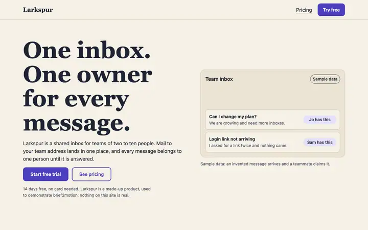

# Site mode

Site mode is how brief2motion builds a whole website, or a single landing page whose job is to get a visitor to do something: sign up, buy, book, register. It puts the work a design studio does first in front of the motion: who the visitors are, what they need to do, what the page may claim, how the pages connect, a phone-first wireframe, design tokens, a visual design, and only then the motion and the build. Five checkers and a token builder then test the plan and the built pages, three of them in a real browser, and write every finding to one file.

The skill tells the agent to use site mode when a brief asks for several pages or for a page that must convert. You can also ask for it by name. The rules the agent follows are in the [Site mode section of SKILL.md](../skills/brief2motion/SKILL.md#site-mode-a-whole-site-or-a-page-that-must-convert); this page explains the same thing for a person.

## The nine stages

Each of the first seven stages writes one short file that a person and an agent can both read. Filled-in copies of every file, for a made-up one-page event, are in [`templates/site-mode/`](../skills/brief2motion/templates/site-mode/).

| Stage | What it settles | File | Checked by |
|---|---|---|---|
| 1. Discovery | the visitors, their tasks, the owner's goal and how it would be observed, constraints, open questions with the assumption taken | `DISCOVERY.md` | `check_plan.mjs` |
| 2. Content and claims | every word per route; each claim has an ID and a source, or is marked DRAFTED | `CONTENT.md` | `check_plan.mjs` |
| 3. Routes | id, path, parent, template, title, description, primary action, states and links of every page | `routes.json`, `SITEMAP.md` | `check_plan.mjs`, `check_meta.mjs` |
| 4. Wireframes | phone-first grey boxes with the real copy and a reachable primary action | `wireframes/<template>.html` | `check_layout.mjs --wireframes` |
| 5. Tokens | colour primitives, light and dark roles, and the text and background pairs the design uses | `tokens.json`, built into `site/tokens.css` | `build_tokens.mjs` |
| 6. Visual design | one idea taken from the subject, type, grid, colour, imagery, one signature element; then the usual stack and style choice and `SPEC.md` | `DESIGN.md`, `ASSETS.json` | `check_plan.mjs` (rights records) |
| 7. Motion | for each movement: its intent, trigger, start and end states, what happens if it is interrupted, its reduced-motion form and its pattern page | `MOTION.md` | `check_site.mjs` |
| 8. Build | semantic HTML first, motion on top | `site/` | everything |
| 9. Checks and a second reader | the journeys a visitor must complete, every check record, a human review | `journeys.json`, `check/qa.json`, `REVIEW.md` | the checkers below |

A small brief compresses the stages instead of skipping them: a one-page site keeps one short entry in each file, and may leave out stages 4 and 7 when there is no template choice and no motion. Stages 1 to 3 and 9 are never skipped, because without them nothing says what the page is for or whether it worked.

Three rules hold throughout. The brief's own facts are the only facts: no invented reviews, logos, customers or numbers, and `check_plan.mjs` fails a drafted claim that looks like proof. Phone first. And every state a page can be in (empty, loading, error, success) is declared in `routes.json`, so the checkers load and measure each one.

Three references support the stages: [page-blueprints.md](../skills/brief2motion/references/page-blueprints.md) gives the section order for a product launch, SaaS, portfolio, agency, event, documentation and e-commerce page; sections 10 to 15 of [design-fundamentals.md](../skills/brief2motion/references/design-fundamentals.md) put type, line length, colour roles, images, the responsive sweep and form states in numbers; and [design-review.md](../skills/brief2motion/references/design-review.md) is the rubric for the second reader.

## The checks

Every site-mode checker appends its records to `check/qa.json`. `check_plan.mjs` and `check_meta.mjs` read the project files; `check_layout.mjs`, `check_a11y.mjs` and `check_journeys.mjs` load the pages in Chrome through playwright-core.

| Script | What it checks |
|---|---|
| `check_plan.mjs` | every route reachable from home, no orphans or duplicates; every visitor task maps to a route and an action; every claim has a source or is marked DRAFTED, and drafted proof (reviews, ratings, logos) fails; every asset has a rights record; wireframes carry the primary action; after the build, the links in the built pages and the absence of the dev-only tuning panel |
| `build_tokens.mjs` | turns `tokens.json` into `site/tokens.css`; rejects missing references and alias cycles; fails any declared text pair below WCAG AA in light or dark (only declared pairs are measured, so declare every pair the design uses) |
| `check_layout.mjs` | at 320, 390, 768 and 1440 px, on every route and declared state, in each theme: no sideways overflow, no clipped text, no text or action overlap, tap targets of 24 px or more (44 px for the primary action on a phone), 45 to 75 characters a line, keyboard focus never hidden under a sticky bar |
| `check_a11y.mjs` | axe-core 4.14.1 on every route and declared state, light and dark, phone and desktop, plus a walk with the Tab key to each primary action |
| `check_journeys.mjs` | the tasks in `journeys.json`, written by role and accessible name (click the link "Start free trial", fill the field "Work email"), on a phone and a desktop width |
| `check_meta.mjs` | title, description, canonical link, a 1200 x 630 share image, robots rules, `sitemap.xml` with absolute addresses |

`check_site.mjs`, the checker every brief2motion page goes through, still runs beside them for frame time, reduced motion, the no-WebGL and no-JavaScript fallbacks, contrast, focus, page weight and third-party requests. Site mode adds checks; it replaces none.

axe-core is fetched from cdn.jsdelivr.net when `check_a11y.mjs` runs, checked against its integrity hash and injected into the checker's own browser page. It is never part of a built site or of this repository.

Each checker has a passing and a failing fixture in [`tests/fixtures/design-checks/`](../tests/fixtures/design-checks/), so a checker that stops catching its failure fails the test suite.

## What the outcomes mean

Every record in `check/qa.json` has one of four outcomes.

| Outcome | Meaning |
|---|---|
| PASS | measured, and within its threshold |
| FAIL | measured, and outside its threshold; it blocks the release |
| REVIEW | a person must look: an ambiguous overlap, text over a picture, a drafted claim that holds a figure, an intended ellipsis |
| PENDING | the evidence does not exist yet: a site not built, a sign-up form that ends at a fixture, axe-core not reachable offline |

Each run ends with one line: `RESULT: PASS`, `RESULT: FAIL` or `RESULT: INCOMPLETE`. INCOMPLETE means nothing failed but something is still PENDING. It is not a pass, and the agent is told to say so instead of reporting that stage as checked.

The exit code is 1 on a FAIL (or when nothing was checked at all) and 0 for both PASS and INCOMPLETE, so a script must read the RESULT line. For a release run, add `--strict`: it also exits 1 on PENDING and on REVIEW. `qa.json` carries the same `verdict`, sets `complete: false` while anything is PENDING, and marks records that were measured on an older build of `site/` as stale.

A green `qa.json` is a floor. It does not replace the second reader in [design-review.md](../skills/brief2motion/references/design-review.md) or a pass with a real screen reader.

## The commands

From the project root, with `S` set to the skill's `scripts` folder:

```bash
node $S/build_sitemap.mjs .                       # SITEMAP.md, and site/sitemap.xml
node $S/build_tokens.mjs tokens.json --qa check   # site/tokens.css, and the contrast pairs into check/qa.json
node $S/check_plan.mjs .                          # stages 1 to 4; after the build also the links and the dev panel
node $S/check_layout.mjs . --wireframes           # the wireframes at 320, 390, 768 and 1440 px
node $S/check_layout.mjs . --themes light,dark    # the built site at the same widths
node $S/check_a11y.mjs . --themes light,dark      # axe-core and the keyboard walk
node $S/check_journeys.mjs .                      # journeys.json
node $S/check_meta.mjs .                          # titles, descriptions, canonical, share image, robots, sitemap
node $S/check_site.mjs site --out check           # motion, fallbacks, weight: still required
```

Every checker takes `--json` for machine-readable output and `--strict` for the release run; `node $S/<script>.mjs --help` lists the rest.

## Worked example: Larkspur

[`examples/larkspur/`](../examples/larkspur/) is a three-page launch site for a shared inbox called Larkspur, built through every stage from [its brief](../examples/larkspur/BRIEF.md). Larkspur is a made-up product, and every page says so near the top and in the footer. The brief allows five facts and forbids everything else: no customers, logos, reviews, ratings or speed claims, because there are none.

<p align="center">
  
</p>

The folder holds the output of each stage, so it can be read in order:

| Stage | Larkspur's file |
|---|---|
| 1. Discovery | [DISCOVERY.md](../examples/larkspur/DISCOVERY.md): two imagined visitors and three tasks (understand it, compare the plans, start the trial), each mapped to a route and an action |
| 2. Content and claims | [CONTENT.md](../examples/larkspur/CONTENT.md) |
| 3. Routes | [routes.json](../examples/larkspur/routes.json) and the generated [SITEMAP.md](../examples/larkspur/SITEMAP.md): home, pricing, and a trial form with its error and success states |
| 4. Wireframes | [wireframes/](../examples/larkspur/wireframes/), with screenshots at 390 and 1440 px |
| 5. Tokens | [tokens.json](../examples/larkspur/tokens.json), built into `site/tokens.css` |
| 6. Design | [DESIGN.md](../examples/larkspur/DESIGN.md), [ASSETS.json](../examples/larkspur/ASSETS.json), [SPEC.md](../examples/larkspur/SPEC.md) |
| 7. Motion | [MOTION.md](../examples/larkspur/MOTION.md): one moment, a message arriving in the inbox drawing and a teammate claiming it, once, in about a second and a half; the finished drawing is the reduced-motion and no-JavaScript state |
| 8. Build | [site/](../examples/larkspur/site/): plain HTML, one stylesheet, one script and the kit; no library, no font file, no third-party request |
| 9. Checks | [qa.json](../examples/larkspur/qa.json), [site-report.json](../examples/larkspur/site-report.json), [journeys.json](../examples/larkspur/journeys.json), [REPORT.md](../examples/larkspur/REPORT.md) |

What its checks recorded on 22 Nov 2026, on an Apple M-series laptop with Chrome 158:

| Checker | Records |
|---|---|
| `check_plan.mjs` | 13 PASS |
| `build_tokens.mjs` | 21 PASS (20 contrast pairs, the lowest 5.73:1) |
| `check_layout.mjs --wireframes` | 72 PASS (in `wireframes/qa.json`) |
| `check_layout.mjs` | 240 PASS (three routes and two form states, four widths, two themes) |
| `check_a11y.mjs` | 32 PASS, no axe-core violations |
| `check_journeys.mjs` | 12 PASS, 2 PENDING |
| `check_meta.mjs` | 20 PASS |
| `check_site.mjs`, all three pages | 74 of 74, with the frame-time budgets on |

So `qa.json` holds 338 PASS and 2 PENDING, and its verdict is INCOMPLETE, on purpose. The trial form is a fixture that checks the entry, shows a thank-you, and sends and stores nothing. The `start-trial` journey proves the interaction on a phone and on a desktop, and stays PENDING for the real sign-up service, because no tool here can prove a service that does not exist. The example's [REPORT.md](../examples/larkspur/REPORT.md) lists that, along with what no tool verified: the second reader's review, a screen-reader pass, forced colours and 200% zoom.

To look at it and run every check again:

```bash
python3 skills/brief2motion/scripts/serve.py examples/larkspur/site    # open the address it prints
bash examples/larkspur/tools/run-checks.sh                              # add --no-perf on a machine with no GPU
```
