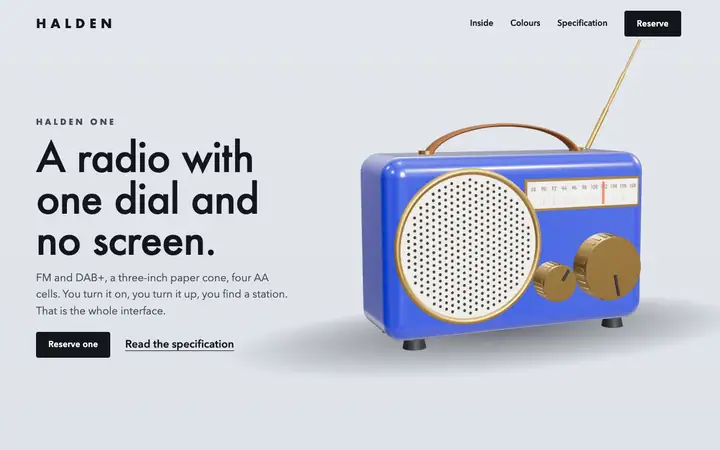

# Halden One

A product launch page with a 3D turntable, built from [BRIEF.md](BRIEF.md). Everything about the product is made up.



- **Stack:** three.js 0.187.0 (MIT), loaded from the CDN after the text is on screen.
- **Motion plan:** at the top of the script, in three lists: on load, on scroll, on input, and what a visitor with reduced motion sees.
- **Notes:** The radio is about forty shapes built in `main.js`: no model file, no photograph. `assets/poster.webp` is a screenshot of the same scene (`index.html?poster`), shown when WebGL is off.
- **Report:** [site-report.json](site-report.json), from a passing run of `check_site.mjs` on an Apple M-series laptop with Chrome 157.

```bash
python3 skills/brief2motion/scripts/serve.py examples/halden-one                              # open the address it prints
node skills/brief2motion/scripts/check_site.mjs examples/halden-one --out check        # measure it again
```
