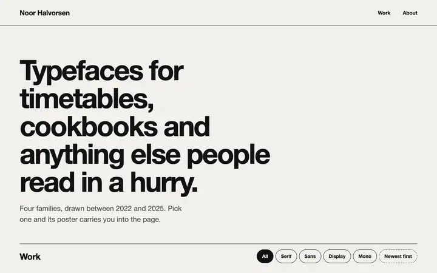

# Noor Halvorsen

A multi-page portfolio with page transitions, built from [BRIEF.md](BRIEF.md). Everything about the product is made up.



- **Stack:** the View Transitions API; no animation library.
- **Motion plan:** at the top of the script, in three lists: on load, on scroll, on input, and what a visitor with reduced motion sees.
- **Notes:** The four posters in `assets/` are SVG files written for this example. `site.js` is loaded with `blocking="render"` so the shared poster is named before the transition starts.
- **Report:** [site-report.json](site-report.json), from a passing run of `check_site.mjs` on an Apple M-series laptop with Chrome 157.

```bash
python3 skills/brief2motion/scripts/serve.py examples/halvorsen                              # open the address it prints
node skills/brief2motion/scripts/check_site.mjs examples/halvorsen --pages work/ember.html,work/quay.html,work/moth.html,work/ledger.html --out check        # measure it again
```
