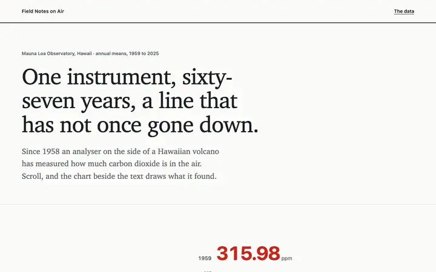

# The Keeling Curve in five steps

A data story, built from [BRIEF.md](BRIEF.md). Everything about the product is made up.



- **Stack:** hand-written SVG, with d3-scale and d3-shape (ISC) for the maths.
- **Motion plan:** at the top of the script, in three lists: on load, on scroll, on input, and what a visitor with reduced motion sees.
- **Notes:** `data.js` holds NOAA's annual mean CO2 at Mauna Loa, 1959 to 2025, with its source and the date it was read.
- **Report:** [site-report.json](site-report.json), from a passing run of `check_site.mjs` on an Apple M-series laptop with Chrome 157.

```bash
python3 skills/brief2motion/scripts/serve.py examples/keeling                              # open the address it prints
node skills/brief2motion/scripts/check_site.mjs examples/keeling --out check        # measure it again
```
