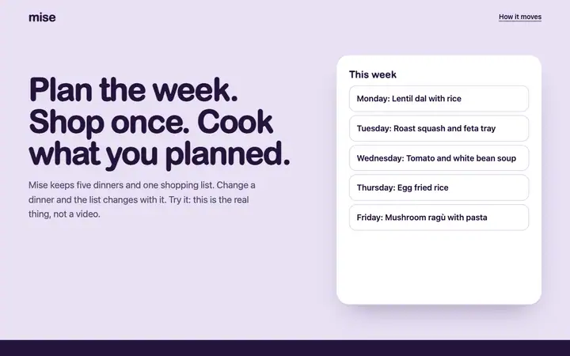

# Mise

An app interface with motion that answers input, built from [BRIEF.md](BRIEF.md). Everything about the product is made up.



- **Stack:** React 19.3.1 and Motion for React 14.14.0, written with htm so there is no build step.
- **Motion plan:** at the top of the script, in three lists: on load, on scroll, on input, and what a visitor with reduced motion sees.
- **Notes:** A real React project would use JSX and a bundler; the Motion code is the same. Rows reorder by drag and from the keyboard (Space, arrow keys, Space).
- **Report:** [site-report.json](site-report.json), from a passing run of `check_site.mjs` on an Apple M-series laptop with Chrome 157.

```bash
python3 skills/brief2motion/scripts/serve.py examples/mise                              # open the address it prints
node skills/brief2motion/scripts/check_site.mjs examples/mise --out check        # measure it again
```
