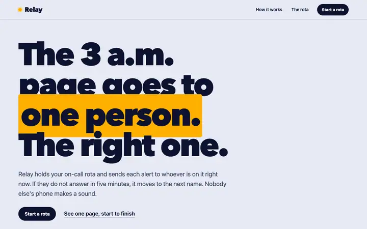

# Relay

A type-led landing page, built from [BRIEF.md](BRIEF.md). Everything about the product is made up.



- **Stack:** Motion 14.14.0 (MIT) as an ES module, with the kit's split text.
- **Motion plan:** at the top of the script, in three lists: on load, on scroll, on input, and what a visitor with reduced motion sees.
- **Notes:** No pictures. The route diagram is inline SVG.
- **Report:** [site-report.json](site-report.json), from a passing run of `check_site.mjs` on an Apple M-series laptop with Chrome 157.

```bash
python3 skills/brief2motion/scripts/serve.py examples/relay                              # open the address it prints
node skills/brief2motion/scripts/check_site.mjs examples/relay --out check        # measure it again
```
