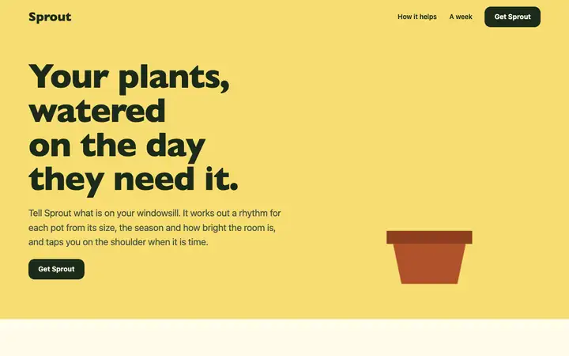

# Sprout

An illustrated landing page, built from [BRIEF.md](BRIEF.md). Everything about the product is made up.



- **Stack:** plain CSS and JavaScript with the kit; lottie-web 5.13.0 for three icons; native CSS scroll-driven animation for the pots.
- **Motion plan:** at the top of the script, in three lists: on load, on scroll, on input, and what a visitor with reduced motion sees.
- **Notes:** The plant is inline SVG. The three Lottie files in `assets/` are written by `tools/make-lottie.py`.
- **Report:** [site-report.json](site-report.json), from a passing run of `check_site.mjs` on an Apple M-series laptop with Chrome 157.

```bash
python3 skills/brief2motion/scripts/serve.py examples/sprout                              # open the address it prints
node skills/brief2motion/scripts/check_site.mjs examples/sprout --out check        # measure it again
```
