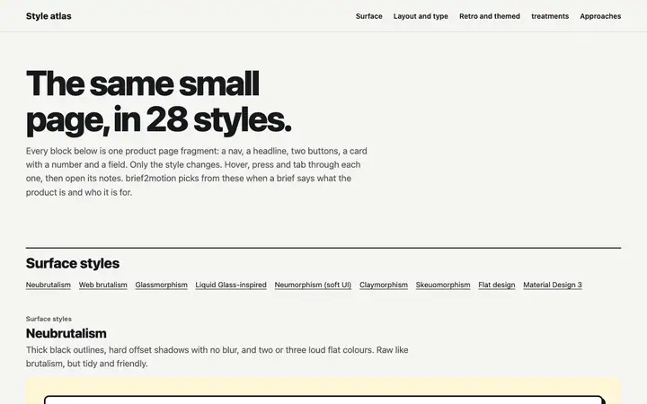

# Style atlas

Every visual style the skill knows, on one page, built from [BRIEF.md](BRIEF.md). Everything about the product is made up.



- **Stack:** plain CSS.
- **Motion plan:** at the top of the script, in three lists: on load, on scroll, on input, and what a visitor with reduced motion sees.
- **Notes:** `index.html` and `atlas.css` are generated by `skills/brief2motion/scripts/build_styles.mjs` from `references/styles.json`. Do not edit them by hand.
- **Report:** [site-report.json](site-report.json), from a passing run of `check_site.mjs` on an Apple M-series laptop with Chrome 157.

```bash
python3 skills/brief2motion/scripts/serve.py examples/style-atlas                              # open the address it prints
node skills/brief2motion/scripts/check_site.mjs examples/style-atlas --out check        # measure it again
```
