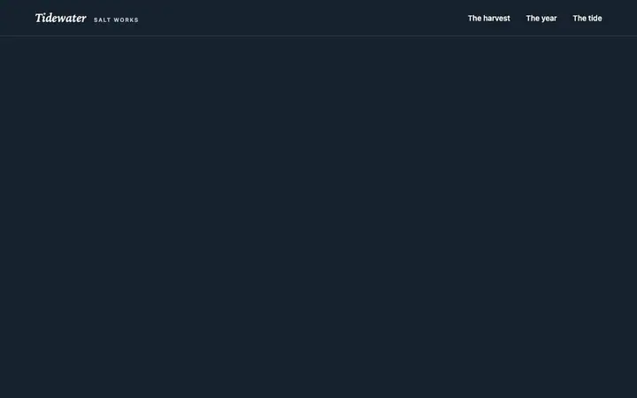

# Tidewater Salt Works

A scroll story for a brand, built from [BRIEF.md](BRIEF.md). Everything about the product is made up.



- **Stack:** GSAP 3.15.1 with ScrollTrigger, SplitText and DrawSVG, and Lenis 1.3.27, as script tags with integrity hashes.
- **Motion plan:** at the top of the script, in three lists: on load, on scroll, on input, and what a visitor with reduced motion sees.
- **Notes:** The 48 pictures in `assets/seq/` are drawn by `tools/make-frames.mjs` on a 2D canvas. Run it again to regenerate them.
- **Report:** [site-report.json](site-report.json), from a passing run of `check_site.mjs` on an Apple M-series laptop with Chrome 157.

```bash
python3 skills/brief2motion/scripts/serve.py examples/tidewater                              # open the address it prints
node skills/brief2motion/scripts/check_site.mjs examples/tidewater --out check        # measure it again
```
